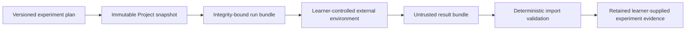

# Financial AI/ML Experiment Execution Boundary

- Status: accepted
- Canonical for: learner-managed experiment runs, validated result import, and the future analytics execution seam
- Related ADRs: [ADR-0011](../../adr/ADR-0011-inert-applied-project-artifacts.md), [ADR-0016](../../adr/ADR-0016-learner-managed-experiment-execution.md)

## Initial Flow

The platform owns plan, bundle, validation, comparison, and provenance meaning.
It does not own or operate the external environment and does not claim that an
imported run occurred as declared or that its output is correct.

## Stable Semantic Contracts

The plan and bundles remain provider-neutral and versioned:

- **Experiment plan:** dataset/use reference, target, split, features, baseline,
  method/model, metrics, leakage controls, environment requirements, parameters,
  limitations, and exact Project snapshot.
- **Run bundle:** permitted immutable inputs and declarations plus complete
  integrity references; no embedded credentials or hidden host dependencies.
- **Execution provenance:** closed execution-mode identity, declared environment
  and toolchain, input/output digests, executor-supplied times, and limitations.
- **Result bundle:** bounded outputs, metrics, logs or summaries, model card,
  adverse/failed result state, and exact plan/run/data/feature/model/environment
  lineage.

Exact wire shapes belong to later executable schemas. Adding fields must not
turn declarations into execution instructions or provider payloads into domain
meaning.

## Future Execution Port

A future analytics interface may define capability discovery and an execution
port around the same run and result semantics. The port is an optional adapter
seam, not an accepted runtime. A future sandbox or execution provider must:

- consume an admitted run-bundle version and return an admitted normalized
  result-bundle version;
- expose capability, environment, quota, cancellation, health, cost, and failure
  differences without leaking provider payloads into Project or experiment
  records;
- remain optional so learner-managed export/import works when it is absent,
  disabled, incompatible, or unavailable; and
- receive separate durable authority and qualification for trust, images,
  packages, identity/tenancy, egress, secrets, scheduling, cleanup, monitoring,
  incidents, provider terms, and local/cloud operation.

The current product exposes no execute operation through this seam.

## Validation Boundary

Validation confirms closed shape, bounds, normalized paths, integrity, version
compatibility, reference closure, data-use declarations, result classification,
and provenance. It does not confirm code safety, external execution, causal
validity, reproducibility on platform infrastructure, model fitness, or
financial truth.

All artifacts remain inert under ADR-0011. Passive preview is separately
allowlisted; otherwise artifacts are limited to metadata and safe download.
Diagnostics redact content, credentials, sensitive paths, and private data.

## Failure and Degradation

Malformed, incomplete, conflicting, stale, unlicensed, or unauthorized bundles
fail without replacing prior valid evidence. An unsupported optional artifact
or future adapter fails narrowly. Experiment planning, export, import, evidence
inspection, comparison, and portable retention do not depend on a sandbox.
