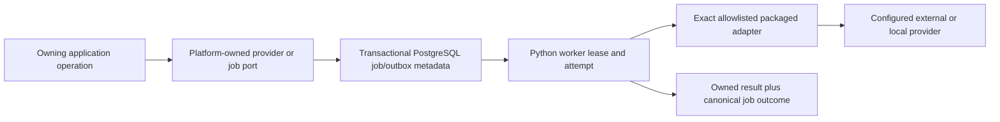

# Provider Admission and Job Delivery Architecture

- Status: accepted
- Canonical for: initial adapter trust class, activation boundary, PostgreSQL job composition, and future host/broker seams
- Decision: [ADR-0018](../../adr/ADR-0018-allowlisted-adapters-postgresql-at-least-once-jobs.md)
- Contracts: [Provider and Plugin Contracts](../contracts/provider-and-plugin-contracts.md), [Durable Job Delivery Contract](../contracts/job-delivery-contract.md)

## Initial Composition

The API and worker use the same application/domain packages. PostgreSQL owns
canonical job metadata and transactional handoff; provider payloads and SDK
types stay in adapters.

## Adapter Activation Boundary

The host activates only an exact allowlisted provider family/ID, adapter and
contract version, package origin, and digest that has current manifest,
conformance, security, data-use, licensing, and operational evidence applicable
to that provider. Configuration and secret presence cannot add code to the
allowlist or enable an adapter by themselves.

The initial executable class is reviewed packaged code trusted to share the
application or worker process. Code needing a stronger trust class is denied,
not silently run in process. Manifest inspection never imports or executes an
unknown package.

## Worker Boundary

Workers claim bounded jobs through the canonical delivery port, establish the
current attempt/lease/fence, resolve permitted secrets only for the target
adapter, recheck authorization/policy, invoke through a versioned provider port,
normalize the result, and atomically publish only while the claim remains
current.

Duplicate invocation is expected under at-least-once delivery. Effect-level
idempotency or reconciliation is part of every handler contract. Worker logs,
metrics, and diagnostics use canonical IDs and classifications and exclude
secrets and unbounded payloads.

## Local and Cloud Profiles

Both profiles preserve the same provider and job contracts, state meanings,
idempotency, fencing, cancellation, uncertainty, retry, and dead-letter rules.
They may use different worker counts, resource limits, provider availability,
and operational automation. Neither profile may claim an external broker or
out-of-process host until separately accepted and qualified.

## Future Isolation and Broker Ports

A future provider-host adapter may put elevated trust classes out of process; a
future broker adapter may replace PostgreSQL claim/notification mechanics.
Neither changes the application operation, canonical job envelope, outcome, or
provider contract. Host RPC and broker receipts remain infrastructure details.

These adapters are absent from the initial baseline. Their absence cannot block
allowlisted in-process providers or PostgreSQL-backed jobs.

## Non-Authority

This architecture does not admit arbitrary plugins, authorize learner-artifact
execution, select provider terms, or define tenant placement. In particular,
ADR-0018 jobs cannot be used to route around ADR-0016's learner-managed
experiment boundary.
