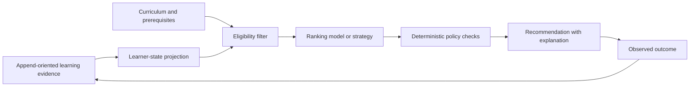

# Adaptive Pathway Architecture

- Status: accepted
- Canonical for: adaptive-learning decision flow and authority
- Related ADR: [ADR-0014](../../adr/ADR-0014-governed-adaptive-learning-research-plane.md)

## Flow

## Responsibilities

- Assessment owns evidence of attempts, scores, and review.
- Learner model owns derived competency and progress state, including versioned
  uncertainty and abstention; it never replaces source evidence.
- Curriculum owns competencies, prerequisites, and pathway structure.
- Adaptation owns eligibility, ranking orchestration, policy application, and recommendation records.
- AI orchestration may provide a ranking or explanation capability but does not own final eligibility or durable learner state.

## Estimate and Publication Boundary

The learner-state estimate and learner-facing publication are independently
versioned. An estimate retains the competency and map version, evidence cutoff,
prediction horizon, calibrated distribution or probability and interval,
coverage, applicability, abstention and drift state, source evidence, and model,
dataset, feature, calibration, and selection-policy versions.

A deterministic publication policy may translate a qualified estimate into
`insufficient`, `developing`, or `demonstrated`, with `review_due` represented
separately from competency. It considers conservative bounds, evidence
diversity and recency, delayed retention, transfer, contradictions,
out-of-distribution status, and drift. Inadequate evidence or calibration
abstains to evidence-only progress. A model score cannot directly create a
grade, credential, prerequisite, authorization, professional-competence claim,
financial-suitability claim, or protected-state change.

## Technique and Qualification Portfolio

- Initial interpretable champions may use time-aware or hierarchical Bayesian
  Knowledge Tracing, logistic knowledge tracing, Bayesian IRT/MIRT, cognitive
  diagnosis, or Bayesian learning/forgetting state-space models according to
  the evidence shape.
- Attention-based, learning/forgetting-aware neural, graph,
  uncertainty-preserving hybrid, and semantic cold-start techniques are
  challengers. A graph technique consumes only a reviewed versioned competency
  graph; semantic or LLM-derived features remain optional experimental inputs.
- Adaptive assessment selects only from a deterministically valid item pool and
  may use expected information gain, posterior entropy reduction, Fisher
  information, or a comparably qualified method. Burden limits cause abstention,
  not a forced conclusion.
- Ranking retains a rule baseline. A conservative contextual bandit may rank
  only eligible actions after qualification. Long-horizon RL or POMDP policies
  remain offline or shadow-only until support, delayed-reward, and safety
  evidence is adequate.
- Qualification progresses from deterministic baseline to offline evaluation,
  shadow operation, bounded model influence, and only then a separately
  reviewed consented online experiment. Every phase retains immediate rule and
  evidence-only fallback.

## Recommendation Record

A durable recommendation should identify:

- learner and learning-context identifiers,
- eligible candidate set or reproducible candidate query,
- selected activity and alternatives where appropriate,
- policy and model/strategy versions,
- relevant learner-state and curriculum versions,
- reason, confidence, and constraints,
- time and expiration,
- later outcome evidence.

## Safety and Evaluation

- Prerequisites, permissions, accessibility constraints, exclusions, and course requirements are deterministic gates.
- Model output is advisory and validated.
- Experiment assignment, consent, and outcome metrics are explicit.
- Evaluation measures learning outcomes and harm or exclusion indicators, not engagement alone.
- A rule-based baseline remains available for comparison and safe fallback.
- Evaluation uses leakage-resistant learner-disjoint chronological and cold-
  start regimes, calibration and subgroup calibration, selective risk/coverage,
  delayed retention, transfer, accessibility, and false-positive demonstrated-
  state evidence. AUC or next-response accuracy alone is insufficient.
- Online exploration is separately reviewed, explicitly consented and
  optional, bounded to eligible actions, propensity-logged, monitored, and
  governed by preregistered learning/harm measures, stopping, and rollback. It
  cannot affect grades, credentials, access, or financial decisions.

