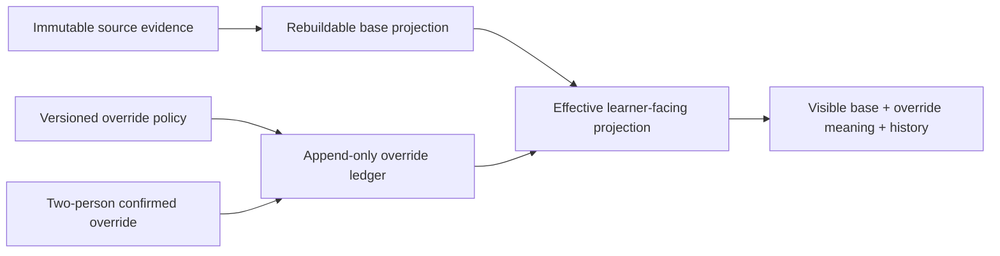

# Instructor Review and Projection-Override Architecture

- Status: accepted semantic boundary; implementation remains blocked on DEC-0016
- Canonical for: review ownership, projection-overlay meaning, activation lifecycle, learner visibility, and replay
- Decision: [ADR-0019](../../adr/ADR-0019-append-only-bounded-projection-overrides.md)

## Ownership

- The module owning source evidence retains that immutable evidence and any
  evidence-specific feedback or revision-request record exposed through its
  public operations.
- Learner model owns base progress/competency projections, the projection-
  override ledger, and calculation of the effective learner-facing projection.
- Audit retains append-oriented integrity and decision references but does not
  become the source of review or projection state.
- Identity supplies normalized actor and authorization context after DEC-0016;
  provider claims never become override authority directly.

No module reads another module's persistence. Review and activation use public
operations or versioned events with exact identities and versions.

## Projection Layers

The base projection remains reproducible from exact evidence and projection
policy. The effective projection is a view over the base plus the current valid
override. Neither calculation rewrites evidence or history.

## Override Policy Registry

Only registered field/value transitions are allowed. A registration declares:

- projection field and semantic owner;
- allowed source and target values;
- exact educational scope and downstream consumers;
- whether a named learning-eligibility rule may consume the effective value;
- maximum proposal and active durations;
- required reason and evidence classes;
- conflict, expiration, reversal, and display policy; and
- policy ID/version with deterministic fixtures.

The initial registry is limited to named derived activity/requirement completion
and named competency publication or `review_due` fields. Unknown fields and
unregistered downstream uses fail closed.

## Lifecycle and Concurrency

A proposal binds one current base-projection digest and one source-evidence set.
A second distinct authorized actor confirms the unchanged proposal. Activation
uses optimistic conflict checks so a source change, projection rebuild, policy
change, competing overlay, authorization change, or expiration requires fresh
review rather than silent rebasing.

Expiration, reversal, supersession, rejection, and appeal disposition append
new records. At most one overlay is effective for the same learner, field, and
scope under the policy's conflict key. The current base is rebuilt when an
overlay ceases to apply.

## Authorization Boundary

The architecture requires separate evidence-read, feedback, proposal,
confirmation, reversal, and policy-administration capabilities. It prohibits
self-confirmation and rechecks authorization at every authoritative transition.

DEC-0016 remains the authority for actor membership, tenant isolation, role
mapping, and database defense in depth. Until it is accepted, CAP-0022 cannot
implement evidence visibility or override activation.

## Visibility and Notification

Activation writes the effective-history fact and notification outbox fact in
one authoritative operation. The application always exposes active status and
history to the learner through an owned read path; optional message-channel
delivery is a convenience and may degrade independently.

Interfaces and exports distinguish base, override, effective, expired,
reversed, superseded, and disputed states. They do not imply the override is a
deterministic score, model estimate, credential, or source-evidence correction.

## Degradation

Feedback and revision requests remain available when overrides are disabled,
the policy lacks an entry, a second confirmer is unavailable, notification
delivery fails, or one projection adapter is unavailable. Denial is narrow and
cannot hide existing history or block unrelated learner evidence.
